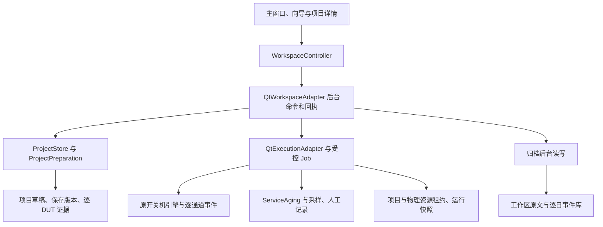

# DUTPilot V1.3.x 统一 GUI 阶段验证报告

2026-11-22 核对当前工作树。操作员已能在 Qt 主程序创建两类项目，逐台准备 DUT，再进入自动开关机或持续业务老化工作台。开关机沿用原执行引擎。持续老化已有独立任务、绑定网卡的 LAN Ping、人工观测及历史导出。视频、语音等业务仍依赖现场证据，长期无人值守与实验室验收尚待开展。[原设计指南](../../../GUI_DESIGN_GUIDELINES.md) · [实施计划和两份指导书对照](../../../docs/GUI_UPGRADE_EXECUTION_PLAN.md)

## 按阶段核对

负责人已确认现场具备测试架和采集接口。具体业务、接口格式、样例与 DUT 映射待交接。当前自动化结果来自本机隔离环境。

本报告固定到首个两类业务工作台候选。标准 Qt 构建运行 3,320 项测试，270 项指定回归命中。冻结版本的 Windows 原生 100%、125%、150% 各通过 112 项、1,930 个受管窗口，隔离违规为零。便携 ZIP 为 55,562,049 字节，SHA256 为 `1C6C3A0E379CFEA6491FA341D672007EBE0003B2358C031154DD56ABB414503F`。本机只做构建与静态核验。后续现场采集文件适配在[下一阶段](../gui_aging_feed_20261122/)记录。[原生结果](native-final/results.json) · [构建输出](build.txt) · [包核验](../../dist/qt-v13x-gui-20261122/PACKAGING_REPORT.json)

人工目视复核保留逐 DUT 准备页三档截图。[100%](native-final/scale-1/typed-project-preparation.png) · [125%](native-final/scale-1.25/typed-project-preparation.png) · [150%](native-final/scale-1.5/typed-project-preparation.png)

| 阶段 | 当前可用行为 | 验证边界 |
|---|---|---|
| 0　审计 | 已只读核对开关机指导书的 540 段、7 表和业务老化指导书的 726 段、8 表。实施计划记载页面、复用模块、两条业务流程、风险和逐阶段任务。 | 开关机以每台 DUT 的 500 轮为验收单位。老化以业务观测、每日检查、48 小时专项及常温 7 天为依据。 |
| 1　设计体系 | Qt 主题、SVG 状态图标、项目徽标、按钮、卡片、日志、横条和圆环已用于展示页或正式工作台。可从源码入口运行 `python run_dutpilot_qt.py --showcase`，使用独立示例数据核对交互。 | 状态文字沿用运行回执，未知和未接入有各自显示。三档验证覆盖展示页及工作台入口；旧模块对话框仍保留各自的既有界面。 |
| 2　主窗口与总览 | 侧栏、顶栏、卡片与列表、实时日志及资源页共用工作区快照。项目以 UUID 去重，可按状态查看打开、运行、等待、最近任务已完成、需关注或待核实的项目；可按项目筛日志。 | 测试模板页索引已打开项目的保存版本。设备页展示缓存和租约，明确刷新后才枚举硬件。串口或电源口占用的统计粒度为物理 COM 口。 |
| 3　向导与公共准备 | 主菜单和 Ctrl+N 进入类型向导，支持 DUT 身份、资源映射、专属配置、返回修改、草稿恢复和旧项目补录。公共准备按依赖区分执行回执、人工记录、独立核验、跳过、失败和重试。保存版本与启动分别等待后台回执。 | 开关机有管理 IP 和预测试步骤；老化有统一 Telnet 凭据、双频 WiFi 和初始检查。两者均校验 Telnet，凭据或映射变化会使相关证据失效。设备侧真实回读、OLT 上线及现场连线仍需核实。 |
| 4　自动开关机 | 类型化项目启动时比对已保存档案、准备结果、执行通道和原配置目标。逐 DUT 表展示最新阶段、当前及已完成轮数、正常回执、失败、重试和有起止事件的轮次耗时。项目圆环取本批参与 DUT 中最低完成比例。原通道网格、串口、任务历史及受控停止仍可进入。 | 缺轮次或分母时进度显示未知。原执行路径保留单台、并行、失败续跑能力；本批证据来自临时项目、模拟回执及原生交互。 |
| 5　全业务老化 | 独立 `service_aging.start` 冻结配置并启动持续监测。界面按 DUT 和业务展示来源、有效次数、成功率、最近成功、失败串、异常及有效观测时长、心跳与恢复。批次历史可筛观测、自动采样、每日或期末记录，逐页查阅并导出整批 CSV。 | 工具批次运行时长、每项业务的有效观测区间及 DUT 自身连续开机时间是三种量。达到计划时长进入待核对末检，仍需工程师按原始证据验收。 |
| 6　可靠性 | GUI 在主线程处理界面回执，后台保存与读取归档。工作区文本与逐日 SQLite 事件并存，结构化事件可按项目、DUT、通道、等级分页。设备任务保留资源租约和运行快照，历史未终态需核实后再处理。 | 旧文本继续按原文查阅。盘写失败和积压有告警；两份归档都写失败时只能报告缺口。短时回归覆盖跨项目隔离、迟到回执与分页；实际断电、磁盘空间耗尽及长期资源曲线需在现场记录。 |
| 7　回归与交付 | 本批同一候选的标准构建、完整基线和全套三档 Qt 原生通过。原生用例从生产控制器进入，使用临时工作区、文件归档和任务台账。 | 目标机启动与业务现场验收待负责人登记。 |

## 当前调用关系与主要文件

- 主窗口与共享组件主要涉及 [main_window.py](../../src/ui/qt/main_window.py)、[dashboard.py](../../src/ui/qt/dashboard.py)、[component_showcase.py](../../src/ui/qt/component_showcase.py)、[showcase_components.py](../../src/ui/qt/showcase_components.py) 和 [progress_widgets.py](../../src/ui/qt/progress_widgets.py)。
- 项目档案、向导和准备主要涉及 [project_profile.py](../../src/models/project_profile.py)、[project_wizard.py](../../src/ui/qt/project_wizard.py)、[project_wizard_controller.py](../../src/ui/qt/project_wizard_controller.py)、[project_preparation.py](../../src/services/project_preparation.py) 和 [project_preparation_jobs.py](../../src/services/project_preparation_jobs.py)。
- 两类运行页面主要涉及 [test_type_panel.py](../../src/ui/qt/test_type_panel.py)、[project_power_plan.py](../../src/services/project_power_plan.py)、[power_run_overview.py](../../src/services/power_run_overview.py)、[service_aging.py](../../src/services/service_aging.py)、[service_aging_history.py](../../src/services/service_aging_history.py) 和 [service_aging_history_dialog.py](../../src/ui/qt/service_aging_history_dialog.py)。
- 资源与归档主要涉及 [workspace_resources.py](../../src/services/workspace_resources.py)、[qt_workspace_adapter.py](../../src/services/qt_workspace_adapter.py)、[workspace_event_log.py](../../src/services/workspace_event_log.py) 和 [archived_logs_dialog.py](../../src/ui/qt/archived_logs_dialog.py)。

## 实际执行的分项验证

首次完整基线通过 3,314 项测试及 270 项指定回归，编译 409 个文件、清单覆盖 399 个源码文件，八类门禁均通过。首轮全套 Windows Qt 原生在 125% 和 150% 各通过 112 项，100% 发现健康面板故障注入提前退出，已修正并启动复验。最终构建及原生复验以对应批次结果为准。[完整基线](baseline.txt)

项目档案、准备、执行及工作区首次组合通过 117 项。类型化开关机准入与历史回放的最终组合通过 82 项，涵盖失败续跑复查父批次快照和真实资源身份。日志和任务隔离的 11 组最终专项通过 237 项，7 个受管窗口、0 违规。上述组合有交叉用例。[首次集成原始输出](integration-initial.txt) · [可靠性报告](RELIABILITY.md) · [可靠性最终输出](reliability-services.txt)

Windows 原生专项在项目的 Qt 环境中，以 `run_gui_child(..., framework='qt', native_render=True)` 启动同一 `scripts/run_tests.py`。下表中的数量均为**每档**，三档分别为 100%、125%、150%。这些批次均运行在经过核验的非输入私有桌面，Qt 守卫违规为零。重复运行的用例按批次列出。

| 批次 | 各档结果 | 主要断言 |
|---|---|---|
| 侧栏、模板、缓存设备 | 组合 3/3 通过，13 个受管窗口；补充空首帧断言后，导航专项 1/1 通过，5 个窗口 | 同名项目按 UUID 进入，已保存版本与草稿有明确区分，打开设备管理读取缓存，空列表能呈现。 |
| 创建、菜单、草稿和老化历史 | 组合 4/4 通过，24 个窗口；补充类型切换等断言后，向导及老化历史 2/2 通过，12 个窗口 | 从原菜单创建与恢复，旧项目补类型，取消确认保留数据。老化详情隐藏循环区，无批次时无时长；切回开关机恢复通道与进度区。真实临时 SQLite 的两个同名项目、103 条数据、按类分页与整批 CSV 均核对。 |
| 结构化归档与旧日志 | 3/3 通过，13 个窗口 | 两个同名项目、两个 DUT、通道与等级组合筛选。101 条匹配事件跨页无重漏；切项目和关闭窗口后旧回执未进入新视图。另验原始 AI 文本、项目串口和导出。 |

原生测试入口为 [qt_project_wizard_probe.py](../../tests/qt_project_wizard_probe.py) 和 [qt_workbench_probe.py](../../tests/qt_workbench_probe.py)。另有已落盘的项目/准备/工作区集成检查 117/117，以及展示页与只读总览的历史阶段记录。[集成检查原始输出](integration-initial.txt) · [展示页三档收据](../gui_design_v13_20261122/showcase-final/results.json) · [工作台阶段报告](../gui_design_v13_20261122/workbench-overview/REPORT.md)

## 软件边界及现场待验

1. **持续业务的自动采集。** 当前自动采集器是绑定网卡及源地址的 LAN Ping。WiFi 双频、STA 视频、IPTV、连续通话、TR069、反复连网、按键/LED、串口观察和可选 EasyMesh 有逐 DUT 的人工记录入口。专属任务尚无这些业务的自动质量或连续性采集器，DUT 的 CPU/内存标记未接入。原串口日志、WiFi 配置与查询工具仍可提供原始证据。DUT 自身连续运行时长、整机离线及重启判定仍缺少可验证的设备启动周期和独立心跳来源。[采集器及记录来源](../../src/services/service_aging_history.py) · [网卡绑定采样](../../src/core/aging_lan_ping.py)
2. **硬件状态与配置来源。** 租约能表示串口、网卡、DUT 身份及已接入的 OLT 等资源占用。系统状态页尚无逐个电源输出通道的物理读数或通用 DUT 连接探测，ADB 终端也未接入统一硬件准入。模板页提供从已保存项目复用配置的入口；独立按型号维护的模板库尚未建立。[宿主机资源映射](../../src/services/workspace_resources.py) · [模板索引](../../src/ui/qt/project_templates_page.py)
3. **真实业务。** 开关机需要在批准的设备架复验逐通道电源/串口/VLAN、管理 IP、预测试、单/多通道时序、失败续跑及每台 500 轮。老化需要核对双频终端与业务配置、每日检查、视频和 TR069 连续性、语音连续 48 小时、LAN 长 Ping 48 小时丢包率低于 1%、期末按键复查及常温 7 天原始记录。已有模拟七天、模拟时钟与人工样例只用于验证计数及取证规则。[两份指导书的逐章对照](../../../docs/GUI_UPGRADE_EXECUTION_PLAN.md)
4. **长期运行与交付。** 目标机需完成旧项目副本往返、权限和 Qt 插件、实际 DPI 与显示器、24/72 小时及更长无人值守的 CPU/内存/线程和响应采样，并核对故障、停止、资源释放与日志尾行。标准包验证以同一候选源码的构建报告和哈希为准。构建机遵守新 EXE 不运行的项目规则。[长期运行取证方法](../pyside6_migration_20261118/long_run_acceptance/README.md)
