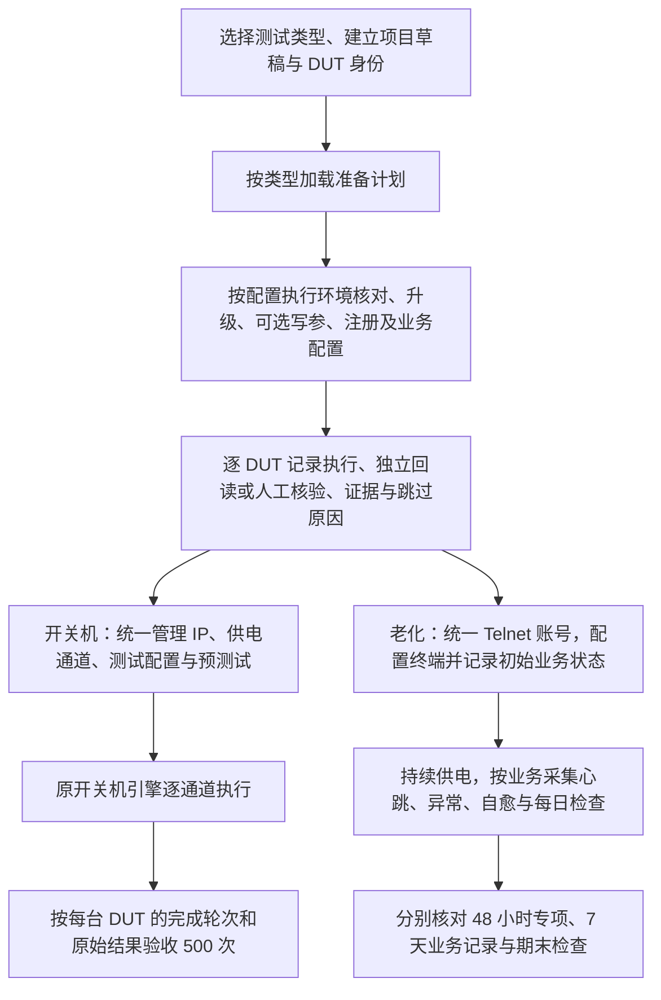

# DUTPilot GUI 升级执行记录

## 当前项目向导

项目向导保留「项目与测试类型」和「确认项目」。通道及旧 DUT 绑定继续从项目主界面的「环境配置」保存。两类测试从主界面确认启动，历史公共准备记录随项目保留。[当前操作说明](../Cheating_machine_execution_tool/line_check_assistant_README.md)

## V1.3.x 现场验收交接

2026-11-23，负责人确认当前 Qt V1.3.0 候选现场验收通过。Phase 0–7 的本轮交付已完成。下表保留确认所对应的验收口径。[现场结论](../Cheating_machine_execution_tool/validation/gui_guidelines_20261123/REPORT.md#现场验收)

使用候选 ZIP 的 SHA256 识别版本。每批保存项目和运行 ID、选中 DUT、接线和资源映射、软件版本、配置快照、操作员与记录时间。实验室结论登记到验收基线及开发记录。[当前候选包](../Cheating_machine_execution_tool/validation/gui_guidelines_20261123/REPORT.md#标准候选包) · [验收基线 §2.19 及 §3](../ACCEPTANCE_BASELINE.md)

| 验收项 | 现场证据 |
|---|---|
| 目标 Windows | 在独立目标机解压完整包，核对启动、已有项目重开与历史读取、实际系统缩放、多屏和窗口恢复。 |
| 自动开关机 | 按指导书核对每台 DUT 500 个已完成轮次、上下电与设备回执、失败与续跑、停止及资源释放。 |
| 全业务老化 | 按批次映射接入现场数据，核对各 DUT 的正常、异常、断流及恢复。保存语音连续通话 48 小时、LAN 长 Ping 48 小时且丢包率低于 1%、常温 7 天及每日检查和期末按键检查的记录。 |
| 无人值守 | 采集 24/72 小时进程资源数据，关联同批工作台响应、任务进展、日志落盘、异常和收尾回执。 |

[目标机验收材料](../Cheating_machine_execution_tool/validation/gui_guidelines_20261123/DUTPilot_field_acceptance.zip)包含采样脚本、现场记录表及当前候选的校验文件。现场采样首条记录绑定 ZIP、进程映像和操作者登记的实际批次。[现场采样与证据说明](../Cheating_machine_execution_tool/validation/pyside6_migration_20261118/long_run_acceptance/README.md) · [全业务老化采集契约](../Cheating_machine_execution_tool/line_check_assistant_README.md#接入现场采集结果)

## 2026-11-23 · 工作台长挂刷新

逐 DUT 工作台先比较项目、测试类型和观测记录。只有计时变化时更新标题并保留表格及当前选择。新观测沿用原来的行、状态和业务判定，并按 DUT 恢复选择。原生测试同时核对计时、选中项、观测更新和业务汇总。[本轮复验记录](../Cheating_machine_execution_tool/validation/gui_guidelines_20261123/REPORT.md)

同一份快照通过 3,366 项完整基线和三档各 117 项 Windows 原生回归。标准构建完成，实际成品的项目模块、Qt 入口、操作员说明与快照一致，ZIP 静态检查通过。[成品校验](../Cheating_machine_execution_tool/validation/gui_guidelines_20261123/package-proof.json)

## 2026-11-22 · 现场验收前的阶段进度

负责人已确认具备现场测试架。本轮先实现协议无关的[逐批次现场采集接入口](../Cheating_machine_execution_tool/validation/gui_aging_feed_20261122/REPORT.md)，具体平台适配与现场验证按业务逐项开展。

| 原计划阶段 | 当前源码与证据 | 仍待完成 |
|---|---|---|
| 0 项目审计 | 已核对两份业务指导书、现有入口、业务执行器及交付记录，见下方起点审计 | 现场差异随实际批次记录 |
| 1 设计体系、2 总览工作台 | 独立组件页、共享状态、项目筛选和总览已接入，已有[三档原生及源码回归记录](../Cheating_machine_execution_tool/validation/gui_design_v13_20261122/workbench-overview/REPORT.md) | 新页面随最终候选一起复验 |
| 3 项目创建与准备 | 两类项目共用新建向导和逐 DUT 准备页。档案进入草稿、保存版本和运行快照。可向旧项目补录，或从已保存项目提取[型号模板](../Cheating_machine_execution_tool/validation/gui_resources_presets_20261122/REPORT.md) | 目标机用实际项目副本核对型号方案应用、人工核验与重开 |
| 4 自动开关机 | 详情和总览使用原 Job 的通道回执，重开后按原批次恢复轮次与时长。正式启动核对类型、已核验的准备步骤、所选通道和目标轮数 | 每台 DUT 500 轮、真实上下电及收尾回执 |
| 5 全业务老化 | 独立监测 Job 接入绑定网卡的 LAN Ping、现场观测文件及人工检查。向导按业务选来源，批次保留原事件与时间，可分页查看、导出 CSV。逐 DUT 的[在线心跳、离线和启动变化](../Cheating_machine_execution_tool/validation/gui_dut_presence_20261122/REPORT.md)可独立追溯 | 将现场接口映射到批次清单，逐项核对心跳、48 小时专项、常温 7 天和期末检查 |
| 6 长期运行 | 结构化异步日志、历史归档、跨进程租约及未知占用保护均有源码回归；设备管理可查看持有者，逐 DUT 的 ADB 声明随批次冻结。串口接收历史使用有界内存，支持老游标与跨块标记[回读](../Cheating_machine_execution_tool/validation/gui_v13x_candidate_20261122/REPORT.md) | 目标机 24/72 小时无人值守采样、临时盘容量和异常退出后的真实硬件复核 |
| 7 回归与交付 | 冻结的整合 Qt 候选完成标准构建，完整基线 3,360 项，三档原生各 116 项，成品 364 个项目模块与冻结源码匹配。[构建结果](../Cheating_machine_execution_tool/validation/gui_v13x_integrated_20261122/build.txt) · [三档原生结果](../Cheating_machine_execution_tool/validation/gui_v13x_integrated_20261122/native-final/results.json) | 干净 Windows、真实机架与长期业务验收。该包对应冻结版本，当前工作区含后续变更 |

下方审计表保留各历史批次的起点和验证范围。

## 2026-11-22 · V1.3.x 起点审计与本轮范围

本次按[规范 §9、§12](../GUI_DESIGN_GUIDELINES.md)复核当前工作树，提交起点为 `f7b500f86`，其中还有未提交的 Qt 诊断等改动。负责人先确认独立组件展示页，随后确认将项目状态展示接入正式工作台。负责人随后确认继续推进只读工作台，在现场验收前完成本页记录的 Phase 2 增量。下文 11 月 21 日的移交表和执行记录保留各自批次的结果。

| 复核项 | 接入前的源码或验证证据 | 对后续实施的影响 |
|---|---|---|
| 启动与页面 | `run_dutpilot_qt.py --workspace` → `WorkspaceController` → `MainWindow`。工具栏进入共享操作，左树按活动分组，中央堆栈有总览和项目详情两页，底部为日志。总览卡片与列表共用模型，详情的通道矩阵和列表共用通道快照。[主窗口](../Cheating_machine_execution_tool/src/ui/qt/main_window.py) · [总览](../Cheating_machine_execution_tool/src/ui/qt/dashboard.py) | 扩展既有页面栈。详情中的操作标签继续打开各自的模块窗口。模板页需先有真实模板来源。 |
| 运行状态与线程 | GUI 定时器每 100 ms 从适配器取快照、结果和日志。适配器在工作线程读取项目台账，与项目执行器组合出不可变的 `ProjectView`、`ChannelView`、`LogView`。[控制器](../Cheating_machine_execution_tool/src/ui/qt/workspace_controller.py) · [工作区投影](../Cheating_machine_execution_tool/src/services/qt_workspace_adapter.py) · [展示模型](../Cheating_machine_execution_tool/src/models/workbench_presentation.py) | 当前“测试类型”可能来自最近的操作标题，配置中的已选通道也不能证明 DUT 在线。后续从版本化的项目类型决定详情布局，从带批次和采样时间的证据决定健康及进度。 |
| 并行、停止与恢复 | 独立资源上的自动开关机已支持跨项目并行，启动及确认时复核，停止绑定所选项目。历史非终态和未知占用仍需核实。其它设备业务有各自的准入限制。[并行与异常退出报告](../Cheating_machine_execution_tool/validation/pyside6_migration_20261118/parallel_power/REPORT.md) · [主机租约](../Cheating_machine_execution_tool/src/services/workspace_resources.py) | 沿用跨进程保护及收尾回执。老化增加 ADB 或 DUT 独占操作前先定义可核实的身份和资源键。关闭展示页面只销毁展示控件。 |
| 配置与日志 | 项目草稿保存为 revision；任务从已保存版本建立 run 快照。适配器追加工作区日志，显示缓冲另有条数和字节上限。旧工作区文本仅含时间、项目和消息。[项目存储](../Cheating_machine_execution_tool/src/services/project_store.py) · [归档读取](../Cheating_machine_execution_tool/src/services/qt_log_history.py) | 后续以项目、DUT、通道、Job 和 run 关联新记录。保留旧文本及缺失字段。分别验证慢盘、写入失败、UI 缓冲裁剪与退出后的文件尾行。 |
| 迁移交接 | 已有旧项目副本重开、原执行器回放、本机诊断与监控的隔离证据。组合包基线 3,267 项、三档各 100 项；后续诊断源码记录基线 3,280 项、三档各 102 项。[组合包](../Cheating_machine_execution_tool/validation/pyside6_migration_20261118/session2_integration/REPORT.md) · [诊断源码](../Cheating_machine_execution_tool/validation/pyside6_migration_20261118/qt_channel_diagnostics/REPORT.md) | 两套结果分属不同输入。最终交接需同一候选的源码、原生回归、标准包、目标机和实验室记录。[现场采样方法](../Cheating_machine_execution_tool/validation/pyside6_migration_20261118/long_run_acceptance/README.md) |

### 页面结构与复用边界

| 页面位置 | 目标入口和数据 | 可复用的当前实现 |
|---|---|---|
| 窗口顶栏 | 系统状态、串口与网卡刷新、设备管理、Ai助手、全局设置；项目切换后按当前项目 ID 解析项目级操作 | 设备清单及租约视图、原工作区命令；保留原生窗口控制 |
| 左侧导航 | 总览、项目管理、活动项目、测试模板、历史记录、全局设置、设备管理 | 项目树及按 ID 选择，历史及设置共用原菜单。测试模板来源为已打开项目的保存版本，设备管理侧栏进入缓存视图 |
| 总览 | 项目统计、可切换的卡片和表格、环境资源、全局日志 | `Dashboard`、`ProjectTableModel`、`SystemHealthPanel`、`LogPanel`；工作区心跳对应软件进程 |
| 项目详情 | 运行概览、公共准备、运行参数与 DUT 配置、通道或业务健康、串口日志、Ai助手及测试结果 | `ProjectDetail`、原生模块窗口、任务历史；开关机与持续老化按保存的项目类型选择专属页 |
| 新建项目 | 选择类型 → 项目及 DUT 身份 → 资源映射 → 公共准备 → 专属配置 → 预测试或初始检查 → 确认启动 | `ProjectStore` 的草稿、版本、快照以及各模块服务。向导先写草稿，由执行服务在启动时再次校验资源与证据 |

### 两类业务的分派与验收

两份原始指导书已只读核对正文及表格。下图给出向导和专属工作台的目标路径；现状和每个步骤的来源见下方「业务依据与流程」。[开关机指导书](网通产品开关机测试指导书_V1.0.doc) · [业务老化指导书](网通产品业务老化测试指导书_V1.0.doc)



现有 `aging.start` 经 `QtExecutionAdapter` 调用原开关机引擎。老化工作台需另建持续监测服务；尚未接入的采集项显示「未接入」，已接入但没有近期观测的项目保留最近证据时间。开关机整批进度取所选通道真实完成轮次的最小值。[执行适配](../Cheating_machine_execution_tool/src/services/qt_execution_adapter.py) · [轮次来源](../Cheating_machine_execution_tool/src/services/legacy_power_test_service.py)

### 接下来的实施顺序

| 阶段 | 可直接执行的任务 | 验收依据 |
|---|---|---|
| 1 · 本轮独立展示 | 在 Qt 源码入口以 `--showcase` 打开组件页。状态标记同时提供图标、文字和语义色。横条和圆环接收同一数值。项目卡、通道与日志复用工作台控件，界面标明示例。 | 三档 Windows 原生验证、宽窄窗口、键盘入口、确认与取消、0/100/未知/未接入、快速更新及动画停止。 |
| 2 · 总览与导航 | 将复核后的语义映射接入实际总览及详情，分别计算等待和完成的项目数，保留任务数与告警数的单位。 | 相同快照在项目树、卡片、表格、详情一致。切页、刷新和筛选期间运行任务可正常停止。 |
| 3 · 向导及准备 | 将测试类型、产品信息与 DUT 身份纳入项目草稿、版本及运行快照。按类型加载准备步骤和依赖，记录人工/自动执行、独立验证与可选跳过。 | 旧项目缺类型可打开并确认；两项目、两 DUT 隔离。换机或更换固件仅使相应下游验证失效；取消、失败和过期回读不能放行。 |
| 4 · 开关机详情 | 复用原引擎及通道历史，以通道事件展示轮次、阶段、重试和停止结果。 | 回放异步通道、停止及失败续跑，逐台与原始事件对账；真实每台 500 次由现场记录确认。 |
| 5 · 全业务老化 | 先确定每项业务的采集端及人工证据，再接入独立的运行状态、心跳、有效观测时长、异常区间和每日记录。 | 模拟断连、跨日、自愈及设备重启。按指导书核对 48 小时语音、LAN 长 Ping 和 7 天业务记录。 |
| 6–7 · 可靠性与交接 | 按真实 Job、进程及资源所有者验证日志持久化、停止与异常恢复，用最终同一源码运行回归并构建。 | 核对旧项目、三档原生、标准包及哈希，记录目标机和真实设备结果，关联同批次 24/72 小时及业务所需的更长采样。 |

**正式工作台的项目状态。** 接入前，同一条 `failed` 快照在项目树和卡片显示为灰色，在详情显示为红色。现由项目树、卡片、表格状态列与项目详情共用状态图标和颜色，具体文字取自执行器的 `state_text`。例如部分子任务失败时保留「部分失败」，预测试缺少结果校验时保留「完成（含未校验）」，人工重启确认后显示「已确认手动重启」。排队原因、项目身份、运行判据与资源保护仍由原服务提供。[主窗口](../Cheating_machine_execution_tool/src/ui/qt/main_window.py) · [卡片与表格](../Cheating_machine_execution_tool/src/ui/qt/dashboard.py) · [项目详情](../Cheating_machine_execution_tool/src/ui/qt/project_detail.py) · [执行结果投影](../Cheating_machine_execution_tool/src/services/qt_execution_adapter.py)

Windows 原生示例覆盖相同项目在四个位置的状态一致性。左树将失败项目标为红色错误图标；带有未校验结果的详情显示橙色徽标，保留完整结果文字。测试另覆盖选中态图标、按项目 ID 导航、窄窗的子进程保护提示，以及未来版本的未知状态值。[部分失败项目](../Cheating_machine_execution_tool/validation/gui_design_v13_20261122/workbench-status/native/scale-1/project-status-overview.png) · [含未校验的项目详情](../Cheating_machine_execution_tool/validation/gui_design_v13_20261122/workbench-status/native/scale-1/project-status-unchecked.png)

本次工作台状态接入的 Windows 原生回归在 100%、125%、150% 各通过 105 项；每档 1,896 个受管窗口，缺失用例与隔离违规均为零。业务投影、模拟回执及入口契约另通过 14 项。[三档原生回归](../Cheating_machine_execution_tool/validation/gui_design_v13_20261122/workbench-status/native/results.json) · [业务专项](../Cheating_machine_execution_tool/validation/gui_design_v13_20261122/workbench-status/status-contracts.txt)

### Phase 2 只读工作台

总览按已打开项目的完整 ID 去重，展示打开、运行、等待、最近任务已完成、需关注和状态待核实六项。每张统计卡与同名下拉筛选共用一个判断。一个项目即使有多个异常通道也只在「需关注项目」里计一次。执行期间出现异常可同时计入运行和关注。卡片和列表另列任务上报的成功与失败数，缺失值显示「—」。[总览](../Cheating_machine_execution_tool/src/ui/qt/dashboard.py) · [展示模型](../Cheating_machine_execution_tool/src/models/workbench_presentation.py)

历史任务以本项目台账中的准入顺序识别最近一次结果。成功回执对应「最近任务已完成」，因此已完成任务的项目重开后可以处于空闲状态，同时出现在该筛选中。含未校验的预测试要与同一 Job 的原结果匹配。历史非终态需要核实；有活动任务时，排队、运行和安全停止可分别查看。项目级挂测结论继续按指导书验收。[工作区投影](../Cheating_machine_execution_tool/src/services/qt_workspace_adapter.py) · [任务历史](../Cheating_machine_execution_tool/src/services/qt_log_history.py)

侧栏复用本地项目管理、历史和设置。测试模板索引列出已打开项目的已保存版本，按项目 ID 进入源项目。设备管理可查看缓存的串口、网卡及租约，操作员显式刷新后更新枚举结果。底部全局实时日志可组合项目、级别和关键词筛选，进入详情再返回会恢复全局选择。[模板页](../Cheating_machine_execution_tool/src/ui/qt/project_templates_page.py) · [工作台导航](../Cheating_machine_execution_tool/src/ui/qt/main_window.py) · [日志面板](../Cheating_machine_execution_tool/src/ui/qt/log_panel.py)

阶段证据和复验入口见[只读工作台验证报告](../Cheating_machine_execution_tool/validation/gui_design_v13_20261122/workbench-overview/REPORT.md)。后续向导仍需记录正式项目类型、DUT 型号及设备身份。逐电源通道占用和 DUT 在线健康需要相应设备的采集来源。

### Phase 1 独立组件展示页

从主源码目录使用项目独立 Qt 环境执行 `python run_dutpilot_qt.py --showcase`。滑块和键盘方向键同时更新横条与圆环；切到「未知」或「未接入」会清空填充并停用应用按钮。「项目与通道」展示原工作台组件，点击卡片或通道可查看示例信息。下方有 DUT、资源和准备步骤卡，以及可筛选的示例日志。展示窗口只持有内存数据。[启动方式](../Cheating_machine_execution_tool/line_check_assistant_README.md) · [页面实现](../Cheating_machine_execution_tool/src/ui/qt/component_showcase.py)

共享颜色定义在 Qt 主题的 `V13_PALETTE`。组件把状态映射到中文、SVG 图标和颜色；「使用中」表示样例电源资源已取得租约。进度控件以报告值作为文字，以短动画更新填充；隐藏或缺少数据时结束动画。展示页复用既有 `ProjectTableModel/CardList`、`ChannelMatrix` 和 `LogPanel`。[主题](../Cheating_machine_execution_tool/src/ui/qt/theme.py) · [通用组件](../Cheating_machine_execution_tool/src/ui/qt/showcase_components.py) · [横条与圆环](../Cheating_machine_execution_tool/src/ui/qt/progress_widgets.py) · [页面下部的资源卡与日志](../Cheating_machine_execution_tool/validation/gui_design_v13_20261122/showcase-final/scale-1/component-showcase-cards-log.png)

在 Windows 私有桌面以显式缩放分别验证 1100 × 800、740 × 580 两种逻辑尺寸。原生断言覆盖 SVG 模式像素、进度终值、未知态、键盘调节、窗口确认与取消、通道点击及日志筛选。三档展示页专项均通过，每档 4 个受管窗口、守卫违规为零。选取以下两张原生截图供人工比对。[100% 宽窗口](../Cheating_machine_execution_tool/validation/gui_design_v13_20261122/showcase-final/scale-1/component-showcase-1100.png) · [150% 窄窗口](../Cheating_machine_execution_tool/validation/gui_design_v13_20261122/showcase-final/scale-1.5/component-showcase-740.png) · [三档专项收据](../Cheating_machine_execution_tool/validation/gui_design_v13_20261122/showcase-final/results.json)

定稿回归在同一组源码和测试输入上，100%、125%、150% 各通过全部 103 项原生用例，合计 309 次，每档 1,890 个受管窗口，缺失用例和隔离违规均为零。首次 100% 批次遇到主题模块并行修改期间的导入错误，定稿已整批复验。此次验证覆盖 Qt 软件界面；目标机、真实硬件和长期挂测仍按迁移计划验收。[定稿原生回归](../Cheating_machine_execution_tool/validation/gui_design_v13_20261122/native-final/results.json) · [本轮相关源码与验证入口指纹](../Cheating_machine_execution_tool/validation/gui_design_v13_20261122/source-inputs.json)

## 2026-11-21 交接核查

**V1.3.0 迁移仍在进行，V1.3.x 业务重构尚未放行。** 此次核查的分支为 `feature/pyside6-migration`，HEAD 为 `5b36f59dad916959dc1b17418f3c46be39250b71`。Qt 源码、门禁、文档和验证材料包含未提交工作，暂存区为空。这个提交号只能定位已提交的起点。正式交接需要对验收时的源码保存 Git 基线，再按本表复核差异。

| 第一阶段交接项 | 可核对的证据 | 剩余条件 |
|---|---|---|
| 功能迁移 | Qt 工作台、项目、通道、六页 DUT 配置、升级、写参、ONU、日志和部分 AI 页面已有逐项报告 | 对照旧入口补齐 AI 权限、审批、诊断联动及平台、多实例控制面。现有 Qt 限制单个设备业务任务，多项目资源冲突、并行停止和意外退出仍需复验 |
| 源码回归 | 核查之初最近已记录的完整基线为 3,211 项，含 239 项指定用例。当时已报告三档 Qt 原生 252 项 | 后续各增量的专项记录见下。正式交接时重跑最终源码完整基线和三档原生检查 |
| Windows 目录包 | 历史验证包以 3,185 项构建基线冻结。此次重新计算其 ZIP SHA256，与报告中的 `e55758a0e62a3739b13ae1e1d8498ed6e5523544b99b161addee3e886f59a384` 一致 | 包早于当前改动。最终源码走标准构建；清洁目标机启动、Qt 插件加载、旧项目及数据迁移需现场结果 |
| 设备与稳定性 | 负责人本次回复“待现场”。2026-11-22 起统一从 Qt 进入，既有现场待验项继续跟踪 | 独占测试架及通道映射、DUT/OLT/电源/网卡/串口、可测试的模型及平台、清洁 Windows 机和实体显示器；记录单/多/16 通道、真实时序与故障、原始日志、停止释放、系统 DPI/多屏、24/72 小时及更长运行期间的进程内存/CPU/线程、响应、结果和资源 |

项目内第一阶段依据为[分阶段迁移计划](../.claude/plans/pyside6-migration.md)、[原附件逐项进度及模块报告](../Cheating_machine_execution_tool/validation/pyside6_migration_20261118/MIGRATION_PROGRESS.md)和[验包记录](../Cheating_machine_execution_tool/validation/pyside6_migration_20261118/QT_DIRECTORY_BUILD_REPORT.md)。第二阶段全文在[仓库根目录](../GUI_DESIGN_GUIDELINES.md)。计划末尾的等待确认条款，由负责人本次授权在第一阶段验收后自动进入常规增量开发。

### 第一阶段剩余软件与现场工作

| 原计划范围 | 本机可继续的工作 | 完成证据 |
|---|---|---|
| Phase 2/5，旧项目数据 | 用项目副本对照 Tk 与 Qt 打开、保存、关闭、重开。旧 Tk 页面草稿按控件位置记录，Qt 提示保留旧草稿并核对已保存配置。Qt 六页草稿按字段保存。负责人于本轮确认 DUT 与写参共用的登录输入在 Qt 保留显式保存，作为与旧 Tk 延迟自动保存的已知差异验收 | 已有专项检查显式保存、放弃、项目隔离及写入失败。现场使用旧项目副本核对草稿、保存前后的配置版本与回显。[草稿恢复](../Cheating_machine_execution_tool/validation/pyside6_migration_20261118/EDITOR_RECOVERY_QT_REPORT.md)及[共用登录输入](../Cheating_machine_execution_tool/validation/pyside6_migration_20261118/PARAMETER_LOGIN_QT_REPORT.md) |
| Phase 5，本机与远程控制面 | 按旧工作台菜单盘点远程可访问项目、多实例管理、AI 权限/审批、设备及串口诊断联动。优先复用现有工作区服务、会话和授权记录。导入接入配置、查看报告已有 Qt 入口 | 从两套主程序逐项核对入口和取消行为。用隔离项目及模拟传输覆盖拒绝授权、过期请求、跨项目、停止会话和退出清理；真实平台连接及现场诊断待指定环境 |
| Phase 3/6/7，多项目与退出 | 从同一工作区的两个项目检查 `qt_workspace_adapter.py` 的单个设备任务限制，对照 `workspace_resources.py` 的所有者和原执行服务的资源申请。模拟重叠资源、独立资源、关闭单个项目、退出时尚有任务、资源未知、日志晚到 | 每次记录两个项目 ID、Job、通道、占用和释放时刻；其他项目的日志、停止和结果均能单独核对。原项目的真实并行、故障和恢复使用负责人分配的资源复验 |
| Phase 8/9，最终交接 | 在下列条件齐备时汇总最终源码、锁定构建和现场批次。高频日志可先用临时项目进行写盘与退出专项复验 | 对应同一候选版本留存完整基线、Qt 三档结果、标准包和哈希。现场记录目标机系统与 DPI、导入的旧版本、DUT/通道和运行批次，关联开始/停止、原始日志、异常处置及 24/72 小时采样。核对 Qt 便携目录在目标机启动及原项目打开结果 |

## 业务依据与流程

使用 Word 只读打开两份原始二进制文档，按正文顺序读取段落及内嵌表格。开关机指导书共 540 段、7 表，业务老化指导书共 726 段、8 表。下表按原章节列出业务要求。接线、无线、语音和 ACS 表中的环境实例保存在原指导书中。[开关机指导书](网通产品开关机测试指导书_V1.0.doc) · [业务老化指导书](网通产品业务老化测试指导书_V1.0.doc)

| 环节 | 开关机指导书 | 业务老化指导书 | 实现与验证方式 |
|---|---|---|---|
| 准备前提、环境 | §2 统一 Telnet 用户名密码及管理 IP，§2.1 核对光路、VLAN/串口/电源映射，§2.2 检查各 DUT 可 Ping | §2 统一 Telnet 用户名密码，§2.1 核对光路及所用 OLT；示例环境无程控电源 | 人工核对连线和光功率，工具复用枚举及环境检查。管理 IP 和专用供电映射按测试类型加载 |
| 版本、个参、注册 | §2.2–2.4 升级、可选写参、OLT 注册及上线验证 | §2.2–2.4 相同能力，示例升级时需人工重启 | 复用原预检、确认、手动分支与任务结果。固件版本回读、ONU 上线各自留证，可选写参记跳过 |
| 业务配置 | §2.5 开启及确认 Telnet，配置所需 WAN、VOICE、TR069 | §2.5 另含双频 SSID、密码、信道及查询验证，服务于 STA 终端 | 复用 Qt DUT 页面背后的服务。区分下发成功、选做的 WAN 回读、语音实际注册和 ACS 侧上线确认 |
| 专项准备 | §2.6–2.7 测试项及查询命令、WiFi 连接、项目信息和运行参数，确认所选样机预测试 | §2.6–2.7 人工核对 WiFi/IPTV 视频、电话、LAN 长 Ping、手机反复连网、按键 LED、串口日志，开始前标记已有异常；EasyMesh 按项目选用，CPU/内存采集能力待接入 | 两套独立前检。人工操作需要操作者、时间和证据。开始时已异常的业务保留初始状态 |
| 执行及验收 | §1.4 每台 500 次，核对 PON、WAN、WiFi 模块/MAC/连接、VOICE、TR069、默认路由、系统启动；§3.2 每日至少一轮检查 | §1.4–1.5、§3 常温 7 天，每日至少检查一轮；视频/IPTV/TR069 等按 7×24 小时，语音连续通话 48 小时，LAN 长 Ping 48 小时丢包率 <1%；按原文分别核对自愈及不可恢复故障；期末完整按键检查 | **负责人于本轮澄清：开关机每台 500 次，全业务老化满 7 天验收。** 开关机 §3.3 的“满7天”不作为开关机终止条件。配置保存项目要求，示例 DUT 数、串口、信道、日期不写死 |

开关机路径：管理地址和凭据 → 接线和受控电源映射 → 版本/按需写参/注册和业务验证 → 专属测试配置与预测试 → 各通道原引擎循环 → 核对轮次、异常与原始结果。

原开关机服务解析第 N 轮完成记录时上报 N；解析第 N 轮开始记录时只计至 N−1。每个通道的已完成值单调且受本次目标限制。整批取参与通道的最小值，通道重试和单纯的界面刷新均不会增加已完成轮次。项目以各 DUT 的记录验收，工作台使用原服务上报的目标。[原轮次解析与聚合](../Cheating_machine_execution_tool/src/services/legacy_power_test_service.py)

业务老化路径：凭据和连线 → 按实际环境升级/按需写参/注册及业务配置 → 下挂终端、初始逐项检查 → 持续供电与每日检查 → 按每项业务的时间窗核对证据 → 人工验收。

## 当前实现和增量任务

当前界面从 `run_dutpilot_qt.py` 进入 `src/ui/qt/application.py`。主窗口由工具栏、项目树、总览/详情堆栈及日志面板组成。总览共用卡片与表格模型，项目详情连接运行概览及各独立模块对话框。正式入口和显式演示入口分别取工作区快照和演示数据。

**项目类型与状态的数据来源需要补齐。** 当前 `QtWorkspaceAdapter._publish` 用最近任务的操作名称填充 `ProjectView.test_type`，设备型号在基础投影中显示为“—”。向导需要保存操作者选定的测试类型和项目产品信息，旧项目缺字段时展示待确认。最近一次操作仍可保留为任务描述。通道、设备和业务应引用同一项目中的明确身份，防止换机后旧通道的结果被计入新 DUT。

**数据新鲜度已有局部实现。** 系统状态面板读取 `WorkspaceHealthView` 的工作线程心跳和资源采样时间，设备清单保留上次成功读取的候选及失败标志。这些来源可复用在工作台资源区。业务老化还需为每种业务定义独立的证据来源、观测时间及有效期，并区分未接入、未观测和过期。采集器离线期间保留最后证据及其时间，恢复采集后依据新证据更新。

```text
Qt 页面、对话框、控制器
   → QtWorkspaceAdapter 工作线程 / QtExecutionAdapter
   → 原 CapabilityService、Job、PipelineOrchestrator
   → 原硬件服务与资源租约
   → 原事件、结果文件和运行快照 → 不可变展示数据 → GUI 主线程

ProjectStore → 项目 draft / revisions / runs
Job 事件库、串口与结果文件 → 任务历史 / 通道详情 / 日志筛选及导出
```

| 顺序及结论 | 现有落点与差异 | 依赖和交付标准 | 必要回归 |
|---|---|---|---|
| 1a 视觉规范与状态，部分实现 | `theme.py` 的 `SHELL_QSS`、`COMPONENT_QSS`、微软雅黑 UI 9 pt、`GAP=12` 及 `status_style` 可复用。品牌色现为 `#0F766E`、背景 `#F5F7FA`，与 §4 建议初值有差异。导航色点、项目卡徽标与通道格各有状态配色。导航将未知与等待同色，错误走灰色回退，详情的未知走警示色 | 第一阶段交接后，沿用既有品牌布局，在主题中确定颜色、字级、数字字体、间距、圆角和语义图标。以项目生命周期、业务健康、实际资源租约及观测时间为独立输入，给图标、文字、颜色及可执行动作建立共用映射 | 在组件展示页和工作台核对空数据、加载、正常、等待资源、停止中、失败、未知、未接入及过期。运行中且业务异常、停止中仍占用串口、健康来源失联三种组合应同时呈现各项事实 |
| 1b 组件复用与动态状态，部分实现 | `theme.button/card/status_badge`、`ProjectCardDelegate`、通道矩阵、`LogPanel` 和 `QProgressBar` 已有。按钮及通道卡使用局部样式，尚缺成套 SVG 状态图标、步骤卡及圆环 | 依赖 1a。卡片和列表共用项目数据；组件展示页覆盖主/次/图标按钮、统计/DUT/通道/资源卡、空态、加载与确认。横条与 QPainter 圆环消费同一已验证数值，缺分母时显示未知。图标覆盖悬停、选中、禁用。动画只在真实数值变化时过渡 | 原生 100/125/150% 下核对宽窄窗口、键盘焦点、无障碍名称、长文案，同一事件在两种进度组件给出相同读数。任务停止时确认按钮禁用时机和最后一次进度 |
| 2a 主窗口、顶栏及导航，部分实现 | `main_window.py` 有原生窗口控制、可折叠项目树、总览与详情堆栈。树按活动任务分组。顶栏已有合并的串口/网卡只读刷新、设备管理、模型、AI、全局设置。历史位于菜单，工作区运行观测位于系统状态面板；模板缺独立页面 | 依赖 1。复用已有只读刷新和 `WorkspaceController` 动作。顶栏显示工作区实际观测；从导航进入项目管理、运行组、模板、历史及设置时沿用当前项目 ID 与已验证入口，新模板需有实际配置来源 | 关闭/重开、搜索、排序及切卡片后选择同一项目。无项目或权限不足时禁用对应动作。刷新枚举、切页、收展导航期间任务继续，停止请求可达 |
| 2b 总览、日志与资源区，部分实现 | `Dashboard` 已共用 `ProjectTableModel` 与筛选代理。四项统计分别为已打开项目、运行/恢复中、需要关注、结果未知/中断。`LogPanel` 支持范围、级别、搜索与导出。`system_health_panel.py` 展示占用采样；设备管理展示枚举与工作区租约 | 依赖 1、2a。依据项目生命周期及 Job 排队和终态记录，分别统计等待、完成的项目数并按项目 ID 去重；明确已打开或已登记项目这一分母，区分告警条数与受影响项目数。设备型号、成功/失败来自项目配置和运行证据。资源区复用 `DeviceInventoryView`、`DeviceLeaseView`；电源串口占用可呈现，具体供电通道、DUT 在线需独立来源 | 临时工作区回放排队、运行、停止收尾、完成、失败、恢复及旧数据；卡片与列表数量一致。项目 A 的日志导出不含 B；枚举失败保留最近读数及采样时间，未采集的端口/连接状态显示未知 |
| 2c 项目创建与公共准备，部分实现 | `ProjectStore` 支持草稿/版本/运行快照；`qt_configuration_service`、`qt_editor_recovery`、`qt_pretest` 及 DUT、升级、写参、ONU 服务可复用。尚缺测试类型向导及可持久化的逐 DUT 准备验证记录 | 依赖 1、2a。按上表加载计划，记录步骤依赖、人工/自动/可选、执行结果、独立验证、日志定位、超时与重试。沿用服务已有超时和危险操作确认 | 新建/返回/重开/旧项目；选做与必做分支；超时、终止、已执行未验证应阻止错误放行 |
| 2d 按测试类型组装详情，部分实现 | `project_detail.py` 以运行概览和模块标签调起单次电源、升级、写参、ONU、串口、DUT 及 AI 窗口。项目树和两种视图都能按 UUID 进入详情。类型目前可能来自最近一次任务 | 依赖 2c 的持久化类型。沿用通道、配置、串口、AI、任务历史/结果及项目选择。以同一详情外壳加载公共准备与专属执行区。开关机展示通道和循环，全业务老化展示业务健康、时长与每日检查。类型不确定的旧项目先让操作者核对 | 同名异类项目切换、执行无关的最近任务、重启项目均保持正确页面与数据。无关测试动作不可触发，未接入业务显示原因；检查详情不改变运行状态 |
| 3 验证失效，部分实现 | 现有绑定和确认可检测项目修改，DUT 查询按目标失效；缺少跨步骤依赖和证据版本 | 依赖 2c。更换 DUT 身份或固件撤销该 DUT 下游验证资格；改 WAN/账号仅失效依赖该配置的验证；原证据可追溯，恢复时复核真实设备 | 两台 DUT、两个项目、改后重开、运行中晚到旧结果和无关配置变更，逐项核对失效范围 |
| 4 开关机工作台，可复用引擎、需补展示 | `legacy_power_test_service`、`qt_execution_adapter`、`qt_power_resume`、通道历史已有原事件/快照。槽位启用、通道最近结果、项目总进度与真实完成循环含义不同。逐轮成功/失败、重试汇总仍需核对事件来源 | 依赖 1–3。按原通道完成事件读分子，展示目标及最近上报阶段；重试沿原轮次，历史/终态保留来源。禁止从启动、历史条数或 UI 时钟加次数 | 单/多通道、异步进度、部分失败、重试/续跑与停止、切页和重开，逐通道比对原始日志 |
| 5 持续业务老化，尚未实现 | `aging.start` 接入开关机；缺少独立持续业务检测源。已有系统健康面板观测工作区自身 | 依赖准备与现场确认的检测源。工具运行时长按工具会话；DUT 连续运行须有同设备、同启动周期证据；有效测试时长仅累计业务证据确认的区间，中断/失联段留为未知。分别呈现成功/有效检查、最近成功与有效检查、心跳及异常起止。达到时长后按逐项证据验收 | 配置 7 天目标及 48 小时专项，并覆盖持续异常、自愈、重启、跨日、失联无心跳、监控未接入；实验室保存每日检查和期末报告 |
| 6 后台可靠性，部分实现 | `QtWorkspaceAdapter` 工作线程、原 Job 事件库、`workspace_resources.py`、运行快照、串口文件及未知任务核实可复用。历史工作区文本缺少部分结构化字段 | 各增量同步验证任务、资源与落盘各自的完成证据。日志关联项目、DUT、通道、步骤与 Job；老记录保留已有字段。恢复时复核实际硬件和人工确认。全局、型号、项目、DUT 与运行参数各自保留归属，凭据沿用私有存储 | 短时自动化覆盖多项目冲突、晚到事件、慢盘/写失败、关闭重试、资源释放与重开。记录线程、积压、原始文件尾行及查询结果；长期运行采集留给下一行 |
| 7 回归与交付，待前序增量完成 | 已有 `scripts/verify_baseline.py`、`scripts/verify_qt_migration.py`、标准 Windows 构建与阶段报告。现场采样脚本可绑定目标进程 | 用同一候选记录源码基线、三档强制原生用例、截图、标准包与哈希；异机启动后核对旧项目、插件与数据兼容。从实际 DUT/OLT/电源记录核对命令、时序、结果、停止及资源释放，再按项目要求完成业务验收 | 真实 24/72 小时及更长无人值守记录需关联 PID/启动时间、运行批次、硬件拓扑、CPU/内存/线程、GUI 响应、采样中断、日志落盘与结果。现场列明故障及恢复。开关机每台 500 次、业务老化满 7 天按指导书逐项验收 |

## 执行进度

### 本轮第一阶段代码收尾

| 增量 | 修改的关键文件（相对于主源码目录） | 回归覆盖 |
|---|---|---|
| 串口窗口可重试部分关闭 | `src/services/qt_serial_terminal.py`、`tests/test_qt_serial_terminal.py`、`tests/qt_workbench_probe.py` | 修复前模拟第二次释放请求被拒，窗口一直处于关闭中。现在先为各标签申请释放，全部受理后再进入整窗收尾。模拟拒绝、正常异步关闭票据、共享监控者保留、再次请求及驱动实际报告关闭失败分别验证 |
| 原通道阶段及完成轮次 | `src/models/workbench_presentation.py`、`src/services/qt_execution_adapter.py`、`src/ui/qt/project_detail.py`、`channel_table_model.py`（同目录）、`tests/test_qt_execution_adapter.py`、原生用例及 `scripts/capability_gui_actions.json` | 使用原任务按通道上报的 stage、completed、total。矩阵、列表、详情复用同一快照。重试可保留最近阶段；原任务已停止时通道退出重试中。原引擎以已选通道完成数的最小值报告整批进度 |
| 更新窗口日志与退出 | `src/services/qt_app_update.py`、`src/ui/qt/workspace_controller.py`、`tests/test_app_update.py`、原生用例 | 确认框、打开下载目录和取消动作的日志在后台顺序写入。慢盘时 Qt 事件循环仍可响应，退出等待更新任务及最后一次日志写入。更新专项 48 项通过 |
| 原会话排查进展 | `src/models/ai_diagnostics.py`、`src/models/qt_ai_chat.py`、`src/services/qt_ai_chat.py`、`src/ui/ai_diagnostic_task_control.py`、Qt 的 `ai_chat_controller.py` / `ai_chat_dialog.py`、原生用例及能力说明和清单 | 当前项目的会话菜单可只读查看已保存的目标、步骤、取证、观察和结束原因。复用原 Tk 文案与过滤范围，空会话和旧记录可见；切换关闭旧窗，迟到数据按会话身份丢弃。实时诊断和远程接入仍有独立的软件与现场条件 |

- 2026-11-21 第一阶段 Phase 9 已备好[现场采样脚本、复跑方法及逐项取证说明](../Cheating_machine_execution_tool/validation/pyside6_migration_20261118/long_run_acceptance/README.md)。采样固定目标 PID 与启动时间，记录 CPU、内存、线程、缺口和结束原因。已用临时进程验证到期、停止及进程退出三种情形，真实 24/72 小时记录待现场。

- 2026-11-21 核对实际源码、两份指导书、迁移报告和历史验证包。当前先处理第一阶段已有入口。第二阶段正式启动时以实际交接提交复核此表。[原迁移进度](../Cheating_machine_execution_tool/validation/pyside6_migration_20261118/MIGRATION_PROGRESS.md)

- 2026-11-21 用临时旧式工程经原项目服务和 Qt 入口复验，7 项通过。旧 INI 导入与备份哈希、保存后关闭重开、旧 Tk 草稿保全、Qt 草稿重启及过期、四项目快照隔离均有结果。旧 Tk 草稿仍须用原窗口恢复，目标机上实际在用版本的数据副本待现场核对。[旧项目往返复验](../Cheating_machine_execution_tool/validation/pyside6_migration_20261118/handoff_20261121_final/LEGACY_PROJECT_ROUNDTRIP.md)

- 同批用临时项目复核了原多项目资源管理。Qt 设备任务收尾前保留租约，关闭 A 保留 B，6 项服务用例及 5 组资源断言通过。底层允许独立资源并行，目前 Qt 入口仍限制一项设备任务。设备业务的并行范围需在具备隔离硬件的环境复验。[多项目准入、停止及未知保护](../Cheating_machine_execution_tool/validation/pyside6_migration_20261118/handoff_20261121_final/MULTIPROJECT_CHECK.md)

- 原网关路由的 5 项隔离用例通过，覆盖项目选择、切换、撤销和请求归属。已逐项查明本机旧会话、权限、远程范围和多实例设置在 Qt 的入口，以及可离线验证和需现场接入的范围。[控制面功能对照](../Cheating_machine_execution_tool/validation/pyside6_migration_20261118/handoff_20261121_final/controls.md)

- 串口、通道和更新日志增量的服务组合 120 项通过。随后在 Windows 私有桌面的 100%、125%、150% 各执行 86 项，全部通过，每档 1,800 个受管窗口，违规为零。保存了两个常用窗口尺寸和三档的原生输出。目视发现通道快照可能重复同一条上报文本，且单窗只列已完成轮次，已纳入后续修正。[原生验证记录](../Cheating_machine_execution_tool/validation/pyside6_migration_20261118/handoff_20261121_final/native/results.json)
